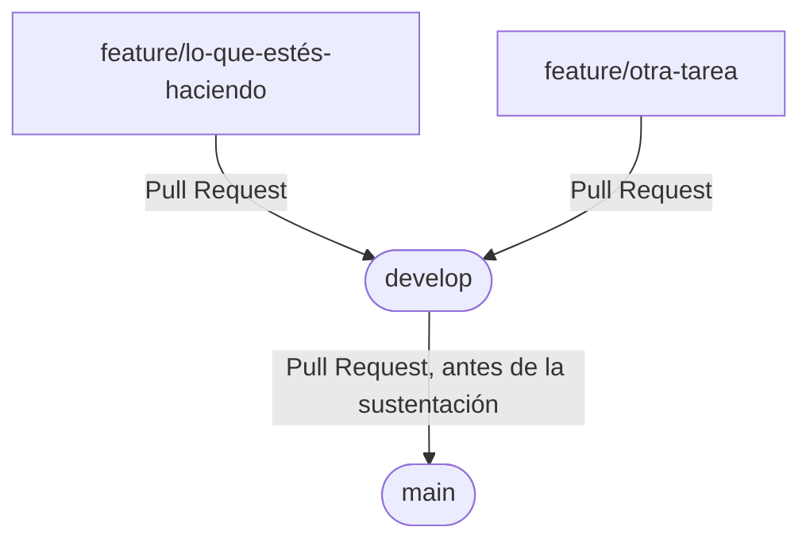

# Guía de trabajo en equipo (Gitflow)

Repositorio: https://github.com/escuela-juridica/herramientas-desarrollo-proyecto.git

Esta guía es para clonar el proyecto, crear tu rama y subir tu trabajo sin pisar el de los demás. Todo el mundo pasa por `develop`, nunca directo a `main`.

> El Avance 2 (Spring Boot + Thymeleaf + PostgreSQL + Spring Security) ya está completo y mergeado en `develop`. Esta guía sigue siendo la forma de trabajar para cualquier cambio nuevo: correcciones, mejoras o el siguiente avance.

## Diagrama de ramas



Cada `feature/*` sale de `develop` y vuelve a `develop` por Pull Request. `develop` solo pasa a `main` cuando todo el equipo ya integró y probó su parte.

## 1. Clonar el repositorio

Solo la primera vez, en tu computadora:

```
git clone https://github.com/escuela-juridica/herramientas-desarrollo-proyecto.git
cd herramientas-desarrollo-proyecto
```

## 2. Cambiarte a `develop` y traer lo último

```
git checkout develop
git pull origin develop
```

`develop` es la rama de integración: ahí se juntan las partes de todos antes de pasar a `main`. Nunca se trabaja directo sobre ella.

## 3. Crear tu rama de trabajo

Tu rama sale **desde `develop`** (asegúrate de haber hecho el paso 2 justo antes). Nómbrala según lo que vas a hacer, con el prefijo `feature/` (o `fix/` si es una corrección puntual):

```
git checkout -b feature/descripcion-corta-de-tu-tarea
```

Este comando se usa **una sola vez** (crea la rama y te cambia a ella). Los días siguientes, para volver a tu rama, solo usas:

```
git checkout feature/descripcion-corta-de-tu-tarea
```

## 4. Trabajar en tu parte

El proyecto es Spring Boot y cada parte vive en su propio paquete/controlador — revisa el `README.md` (secciones "Estructura de carpetas" y "Rutas") para ubicar rápido dónde está lo que necesitas tocar:

- **Páginas públicas** (`/inicio`, `/catalogo`, `/nosotros`, `/contacto`): controladores en `controller/`, templates en `templates/`, CSS/JS propios por página en `static/css/` y `static/js/`.
- **Login / seguridad**: `config/SecurityConfig.java`, `security/AdminAuthenticationSuccessHandler.java`, `service/AdministradorUserDetailsService.java`.
- **Panel administrativo** (`/admin/**`): `controller/AdminController.java` y `controller/AdminCursoController.java`, templates en `templates/admin/`, estilos en `static/css/admin/`.

Si vas a tocar un archivo que otra persona también está editando en paralelo (ej. `catalogo.html`, `admin/cursos.html`), avísale antes para no pisar su trabajo — esos archivos se han compartido varias veces durante el proyecto y es la fuente más común de conflictos de merge.

**Todos**: revisar el `README.md` (sección "Convenciones de código") antes de empezar — ahí está cómo están organizados las entidades, los `Service`/`Repository`, y por qué `ddl-auto=validate` significa que nadie debe tocar el esquema de la base de datos sin avisar (eso va en `script/init.sql`, no se toca desde código).

## 5. Guardar tus cambios (commit)

Cada vez que avances algo importante:

```
git add .
git commit -m "feat: [descripción corta de lo que hiciste]"
```

Ejemplos de buenos mensajes de commit:
- `feat: listar cursos desde la base de datos en /catalogo`
- `feat: busqueda dinamica de cursos con fetch`
- `fix: corregir validacion de fechas en el formulario de curso`

## 6. Subir tu rama al repositorio

La primera vez que subes tu rama:

```
git push -u origin feature/tu-rama-aqui
```

Las siguientes veces, ya alcanza con:

```
git push
```

## 7. Actualizar tu rama con lo nuevo de `develop`

Antes de abrir el Pull Request (o si pasó tiempo desde que la creaste), trae los cambios que otros ya subieron a `develop`. Esto es importante cuando varios comparten los mismos archivos:

```
git checkout develop
git pull origin develop
git checkout feature/tu-rama-aqui
git merge develop
```

Si aparece un conflicto, Git te va a marcar los archivos afectados — resuélvelos con la persona con la que compartes el archivo si hace falta, guarda, y luego:

```
git add .
git commit
```

## 8. Abrir el Pull Request

En GitHub, entra al repositorio y crea el Pull Request de tu rama **hacia `develop`** (no hacia `main`). Antes de pedir que lo revisen:

- Levanta la app localmente y prueba tu parte en el navegador (escritorio y ventana angosta).
- Si compartes archivo con alguien, avísale antes de mergear para no pisar su trabajo.
- Confirma que `mvnw` compila sin errores.
- Asigna un **reviewer** (botón "Request" en el panel derecho del PR) — no es obligatorio para que GitHub lo bloquee, pero sin avisarle a alguien el PR puede quedarse esperando sin que nadie se entere.

## Comandos importantes (resumen)

| Comando | Para qué sirve |
|---|---|
| `git status` | Ver qué archivos modificaste antes de hacer commit |
| `git checkout develop` | Cambiarte a la rama de integración |
| `git pull origin develop` | Traer lo último de `develop` — hacerlo **siempre antes de empezar a trabajar** |
| `git checkout -b feature/tu-rama` | Crear tu rama (solo la primera vez) |
| `git checkout feature/tu-rama` | Volver a tu rama en los días siguientes |
| `git add .` | Marcar tus cambios para el commit |
| `git commit -m "mensaje"` | Guardar tus cambios en tu rama local |
| `git push -u origin feature/tu-rama` | Subir tu rama al repositorio (primera vez) |
| `git push` | Subir cambios nuevos (siguientes veces) |
| `git merge develop` | Traer a tu rama lo nuevo que ya se integró en `develop` |

## Reglas que no se rompen

- Nunca trabajar directamente sobre `develop` o `main` — siempre en tu `feature/*`.
- `develop` se mergea a `main` solo cuando todo el equipo terminó y probó su parte, antes de la sustentación.
- Nadie cambia `script/init.sql` (el esquema de la base de datos) sin avisar al resto — todos dependen de esas mismas tablas.
- **`main` y `develop` tienen protección activada en GitHub** (Ruleset): no se puede hacer `push` directo a ninguna de las dos, y todo Pull Request necesita **al menos 1 aprobación de otra persona** antes de poder mergearse — ni siquiera el autor puede aprobar su propio PR. Esto ya no es una regla de confianza, GitHub la bloquea técnicamente.
